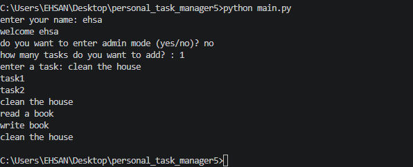

# Personal Task Manager 


A simple task manager built with python 

# Features
- add multiple tasks
- save tasks
- load saved tasks
- admin mode
- set task priority

## task priority 
each task can have one of these priority levels:
- low
- medium
- high
  
# Requirements
- python
- python-dotenv
  
## Project structure
```text
personal_task_manager5/
│   .env.example
│   .gitignore
│   ehsan.txt
│   main.py
│   README.md
│   tasks.py
│
├───img/
│       Animation.gif
│       image.png
│
└───
```
## installation
installl the required package:

```bash
python -m pip install -r requirments.txt
```

## Envoirment setup
create a `.env` file in the project folder 

Use `.env.example`

add your admin password

```env
admin_pass=your_password_here
```

replace `your_password_here` with your own admin password

## run the program
run the main file
```bash
python main.py
```
## screenshot


## Demo


